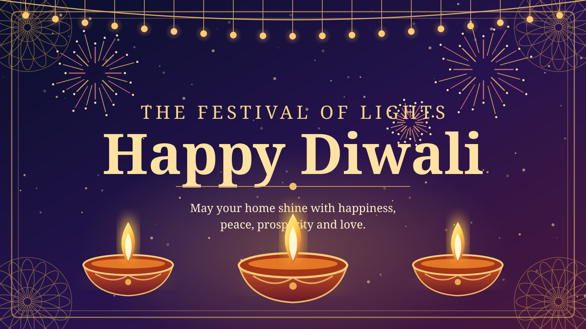
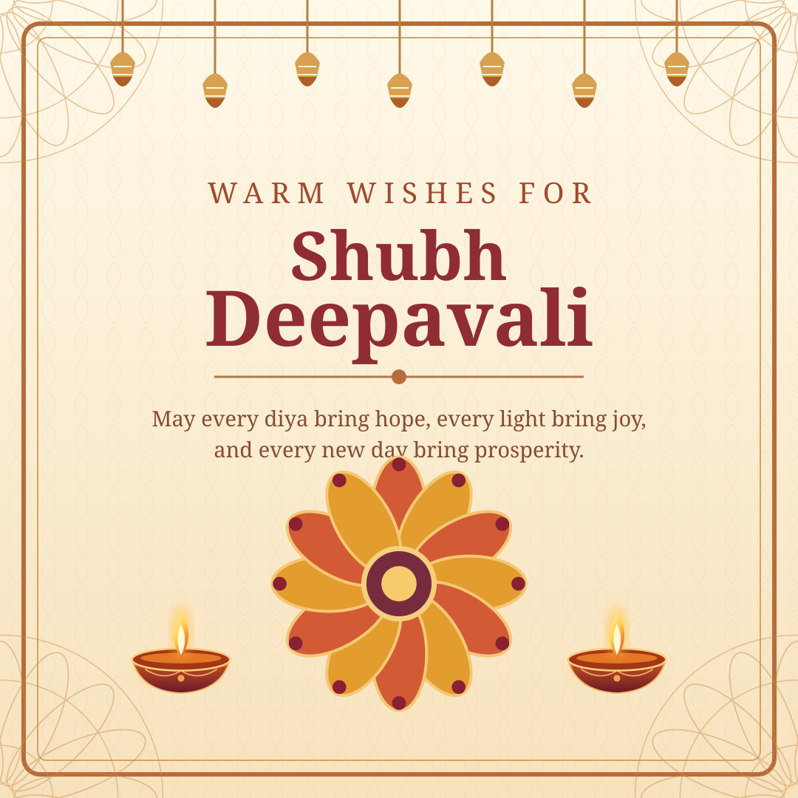
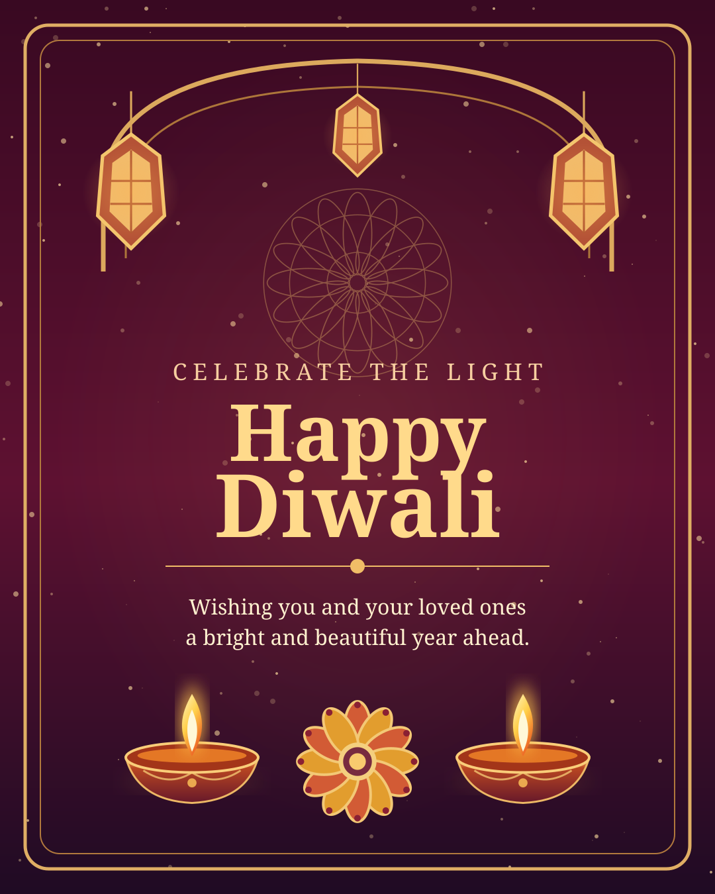

# Diwali 2026 Greeting Artwork

Three original, editable SVG designs for festive greetings. SVG is a vector-image format that stays sharp at any size.

| Design | Preview | Size |
| --- | --- | --- |
| Night-sky banner |  | 1600 × 900 |
| Warm square card |  | 1080 × 1080 |
| Royal portrait card |  | 1080 × 1350 |

## Files
- [Happy Diwali banner](happy-diwali-banner.svg) — website headers, greeting banners, desktop wallpapers
- [Shubh Deepavali square](shubh-deepavali-square.svg) — WhatsApp, Instagram, square greeting cards
- [Royal Diwali portrait](royal-diwali-portrait.svg) — stories, posters, vertical greeting cards

These files were created as standalone SVG illustrations. Open in a browser or vector editor, or export them to PNG/JPG as needed.
